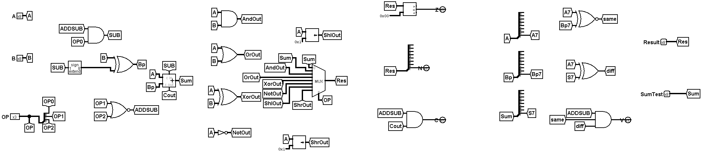
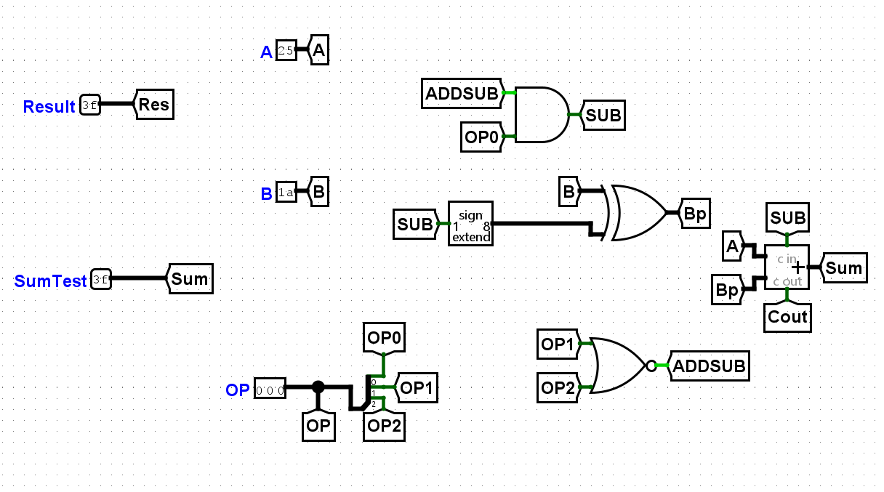
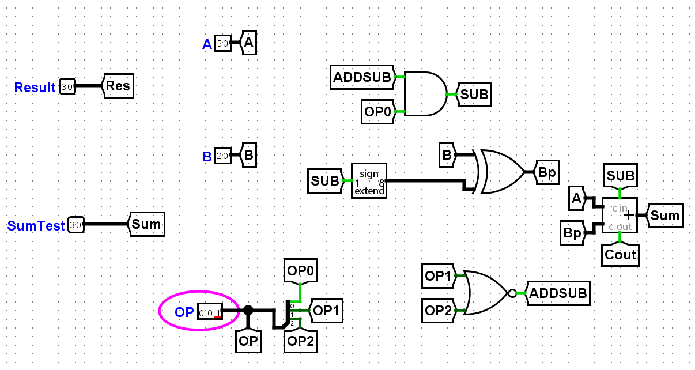
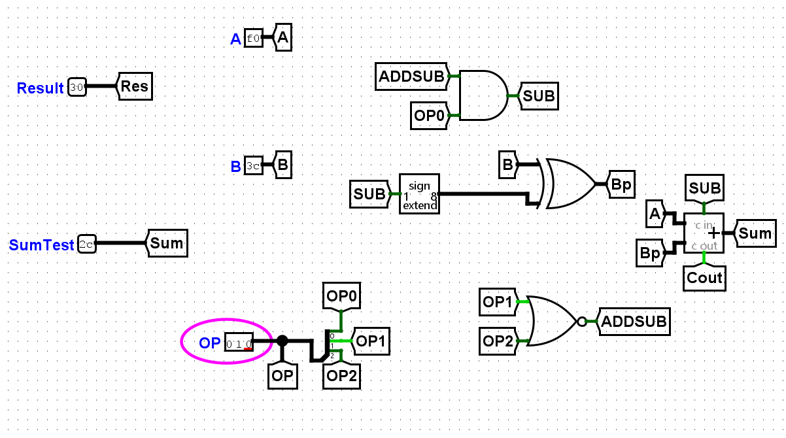
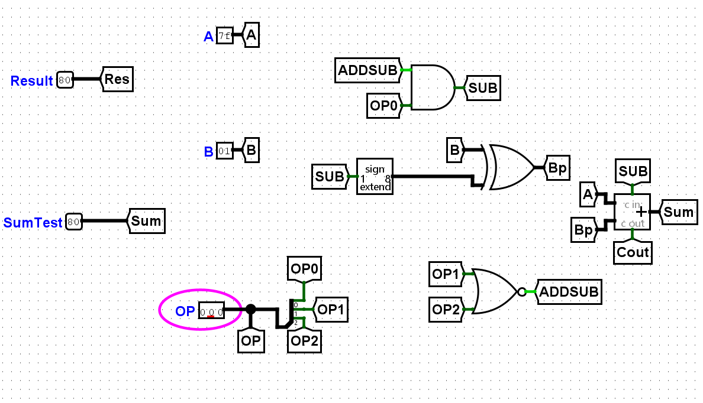
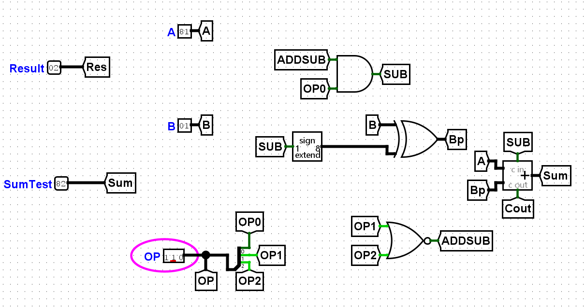

# 8-bit ALU (Logisim Evolution)

An 8-bit Arithmetic Logic Unit designed and simulated in Logisim Evolution. It performs 8 operations selected by a 3-bit opcode and reports four status flags. A Python reference model is included to verify the circuit.

## Screenshots

## Operations

| OP | Operation | Description |
|----|-----------|-------------|
| 000 | ADD | A + B |
| 001 | SUB | A - B |
| 010 | AND | A and B (bitwise) |
| 011 | OR | A or B (bitwise) |
| 100 | XOR | A xor B (bitwise) |
| 101 | NOT A | Bitwise complement of A |
| 110 | SHL | Logical shift of A left by 1 bit |
| 111 | SHR | Logical shift of A right by 1 bit |

## Status Flags

- **Z** (zero): result is 00
- **C** (carry): carry-out for ADD and SUB (for SUB, 1 means no borrow); 0 for other operations
- **N** (negative): most significant bit of the result
- **V** (overflow): signed overflow for ADD and SUB

## Design

- Adder/subtractor: B is XORed with the SUB signal and SUB is used as the carry-in (two's complement subtraction)
- Logic unit: 8-bit AND, OR, XOR and NOT gates
- Shifters: logical shift left and right by one bit
- An 8-to-1 multiplexer driven by the OP input selects the result
- Flag logic: comparator for Z, result bit 7 for N, carry-out gated by ADD/SUB for C, and sign-bit comparison for V

## Test Results

All of these were checked on the circuit and match alu_reference.py.

| A | B | OP | Operation | Result | Z | C | N | V |
|---|---|----|-----------|--------|---|---|---|---|
| 25 | 1A | 000 | ADD | 3F | 0 | 0 | 0 | 0 |
| FF | 01 | 000 | ADD | 00 | 1 | 1 | 0 | 0 |
| 7F | 01 | 000 | ADD | 80 | 0 | 0 | 1 | 1 |
| 50 | 20 | 001 | SUB | 30 | 0 | 1 | 0 | 0 |
| 10 | 20 | 001 | SUB | F0 | 0 | 0 | 1 | 0 |
| 80 | 01 | 001 | SUB | 7F | 0 | 1 | 0 | 1 |
| F0 | 3C | 010 | AND | 30 | 0 | 0 | 0 | 0 |
| F0 | 0F | 011 | OR | FF | 0 | 0 | 1 | 0 |
| AA | FF | 100 | XOR | 55 | 0 | 0 | 0 | 0 |
| 0F | 00 | 101 | NOT A | F0 | 0 | 0 | 1 | 0 |
| 81 | 00 | 110 | SHL | 02 | 0 | 0 | 0 | 0 |
| 81 | 00 | 111 | SHR | 40 | 0 | 0 | 0 | 0 |

## How to Run

1. Install Logisim Evolution
2. Open alu8.circ
3. Use the Poke tool to set A, B and OP, then read Result and the flags
4. Optional: run python alu_reference.py to print the expected values

## Author

Rony - https://github.com/Rony60031
